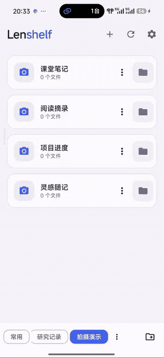
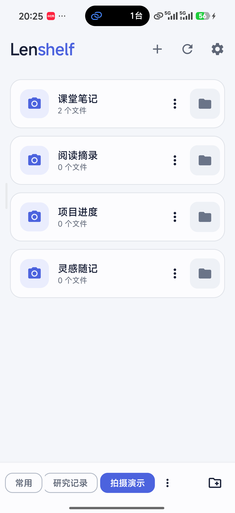
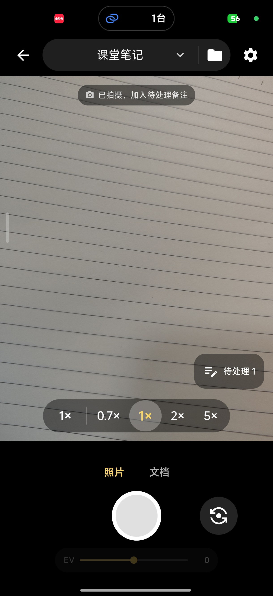
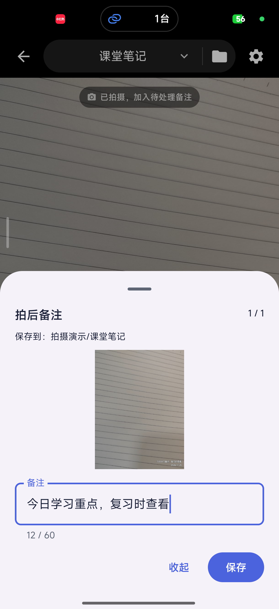

# Lenshelf

**先选分类，再拍摄，照片和视频直接保存到对应文件夹。**

Lenshelf 是一款 Android 分类相机，适合日常记录、学习资料和项目留档。用文件夹组织分类，拍摄时完成归档，减少事后整理。

**[下载 Android 安装包](https://github.com/suyoutzy/Lenshelf/releases/download/v0.9.1/Lenshelf-v0.9.1.apk)** · [版本说明与校验文件](https://github.com/suyoutzy/Lenshelf/releases/tag/v0.9.1)

当前版本 **0.9.1**，支持 **Android 10 及以上**；通用 APK 约 **202 MB**。

## 先拍摄，备注稍后补

进入分类连拍两张，先收起填写框，再从待处理入口逐项补备注。确认后，照片带上备注和拍摄日期，保存到拍摄时选定的分类。

[观看 MP4 操作视频](docs/media/capture-notes.mp4)

## 界面预览

| 分类归档 | 拍摄与待处理 | 填写备注 |
| :---: | :---: | :---: |
|  |  |  |

0.9.1 真机截图，使用演示分类与空白笔记纸。

## 主要功能

| 功能 | 可以做什么 |
|---|---|
| 分类归档 | 按用途建立文件夹和分类，照片、文档和视频直接保存在选定目录，可用系统文件管理器查看 |
| 文档拍摄 | 自动识别纸页、裁剪和透视矫正，提供原色、增强、黑白；增强可减轻纸面灰暗和局部阴影 |
| 时间水印 | 照片和视频共用日期或日期加时分的水印；视频整段使用开始录制的时间 |
| 拍后备注 | 拍完后填写简短备注，也可收起继续拍摄，稍后逐项处理 |
| 本地使用 | 无账号、无广告、无统计、无云同步，不申请互联网访问权限 |

每个分类独立记住相机设置：默认开启仅日期水印和同步防抖，关闭井字格、拍后备注和闪光灯；文档效果默认为原色。录像沿用照片取景时选择的倍数，支持暂停和继续；防抖是否生效取决于手机与镜头能力。

## 快速上手

1. **选保存目录**：安装并打开应用，选择一个用于长期保存照片和视频的根目录。
2. **建分类**：首页顶部“＋”新增分类；需要分组时，用底栏的文件夹加号新建一级文件夹。
3. **开始拍摄**：点击分类进入相机，短按快门拍照，长按开始有声录像；切换“文档”可拍摄纸质资料并自动处理保存。

例如，在“课程学习”文件夹下建立“课堂笔记”分类，成片会保存到 `根目录／课程学习／课堂笔记`。点击分类卡片的文件夹图标即可打开对应目录。

需要备注时，在该分类的相机设置中开启“拍后备注”。填写框可收起；稍后从取景框或首页的待处理入口继续。操作细节见[使用指南](docs/USAGE.md)。

## 隐私与存储

拍摄和媒体处理在设备本地完成。相机权限用于拍摄，麦克风权限仅用于有声录像；应用通过系统目录选择器取得你授权目录的访问权限。完整权限与数据说明见[隐私说明](docs/PRIVACY.md)。

- **删除分类会删除实际文件夹及全部内容**，包括照片、视频和子目录，操作前会要求确认；一级文件夹仅允许删除空目录。
- 已保存到授权目录的媒体不会因卸载应用而自动删除；**待备注、待保存素材及设置仍保存在应用内，卸载或清除数据会丢失**。
- 拍摄完成后请留意保存状态；保存失败可重试，进程中断后下次打开会恢复未完成任务。

## 使用范围

- 文档模式目前不提供 OCR、多页 PDF、图库导入或曲面书页展平；识别和增强效果会受到光线、反光及纸面弯曲影响。
- 当前没有应用内图库，可通过系统文件管理器查看已保存的照片和视频。
- 录像及防抖能力因设备而异；应用不提供常驻后台录制或持续处理服务。

## 反馈与文档

遇到问题或有功能建议，欢迎[提交 Issue](https://github.com/suyoutzy/Lenshelf/issues)。请附应用版本、手机型号、Android 版本和复现步骤，并去除私人媒体及目录信息。

- [使用指南](docs/USAGE.md)：拍摄、备注、分类管理和保存恢复
- [构建与开发](docs/BUILD.md) · [参与贡献](CONTRIBUTING.md)
- [版本记录](CHANGELOG.md) · [文档索引](docs/README.md)

## 开发与致谢

本项目采用 vibe coding 方式开发，主设计师为 GPT-5.6sol、GPT-6.1sol。名称由 Lens（镜头）与 Shelf（收纳）组合，表达“拍摄时即归档”；[品牌说明](docs/BRAND-NAME.md)。

## 许可证

Copyright 2026 Lenshelf project。采用 [Apache License 2.0](LICENSE) 开源。
